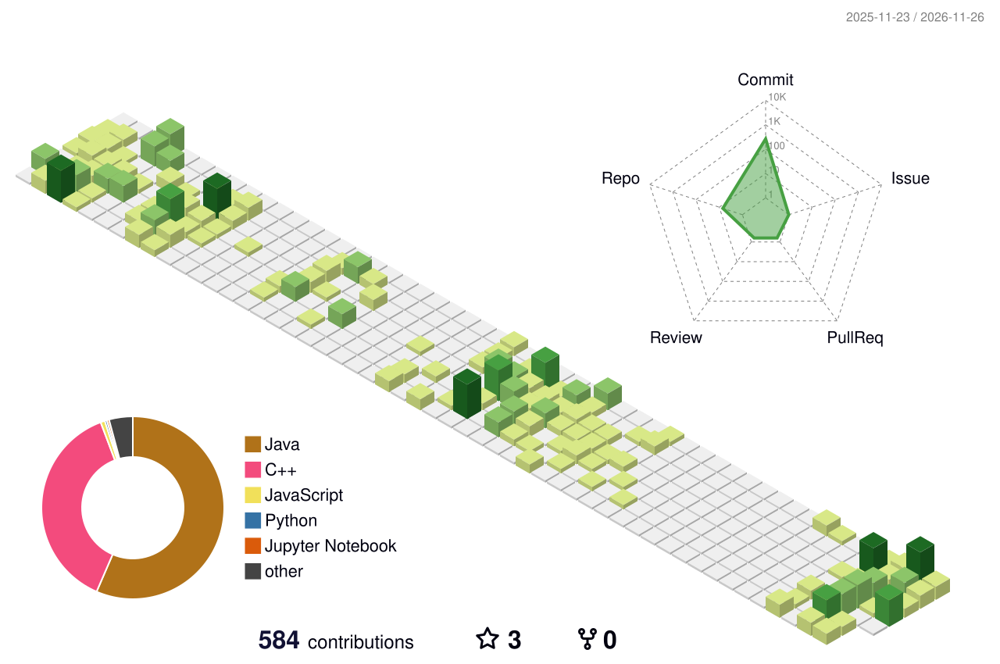

  
  
  
  

  

    
    
    <!--  -->
    <!--  -->
    <!--  -->
    
    
    
    
  

<h2 align="center">
  
  Tech Stack & Interests
</h2>

  
  
C++ &nbsp;·&nbsp; Java &nbsp;·&nbsp; Python

  

    
    
    
  

  
Exploring diffusion models, large language models, and AI agents.

<h2 align="center">
  
  Contributions
  
</h2>

  
  
  

<h2 align="center">
  
  GitHub Activity
  
</h2>

  <i>Thanks for visiting — let's build something intelligent together.</i>

